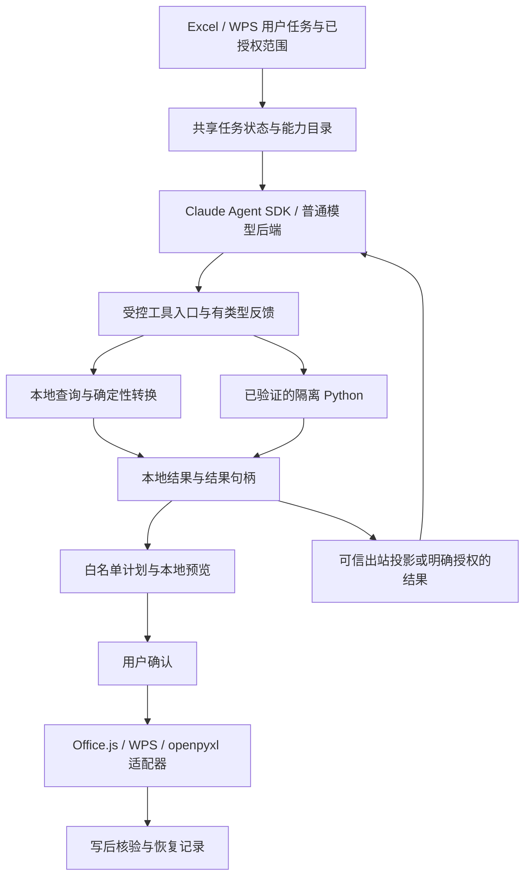

# Claude Agent SDK 接入诊断与表格能力扩展建议

## 2026-10-19：第一批业务闭环与统一主线

第一批合成案例（两张来源表 + 一张输出表；空键、重复键、未匹配；关联/清洗/汇总/异常明细）
已在真实模型 + SDK + Docker 上得到完整结果，并在替身宿主上完成"自动执行一次 → 回读 →
确认只清标记 → 保存工具 → 撤销"与因果变化重跑。**真实 Excel / WPS 实机仍未执行**，
三类证据分档见 [统一主线计划](SDK_MAINLINE_PLAN_2026-10-19.md)。

身份问题（「暂时无法核实当前目标」）在第六轮已按共享层的授权集合规范形修复；本轮只补强
在线集成证据（去掉固定证据键、按非目录顺序选择），未重复改判据。跨进程消费用例原先等待
已取消的「执行到 Excel」入口，已按现行"计划到达即执行、确认不重复写"契约更新并增加断言。

已核实 `claude-agent-sdk 0.2.159` 提供 `resume` / `fork_session` / `session_id` /
`get_session_messages` / `session_store`；当前适配器仍使用 `--no-session-persistence`，
产品侧会话恢复**未接入**。下一批唯一优先目标是 SDK 任务/会话恢复，先交隐私与生命周期
设计，不擅自打开持久化。后续顺序与边界以统一主线计划为准。

## 2026-10-18：WPS 能力补齐进度

动作清单按类型去重为 37 类，旧“38 类 / 缺 28 类”口径有误。当前 12 类有实现（含属性/变体子集），25 类尚未实现；不能将其当作 SDK 改造完成百分比。本轮增加填充、数字格式、写表、值/链接复制及本地计算，扩展条件复制/清空、垂直对齐和可恢复边框，并修正异步写入复核及部分失败恢复。删除工作表、原生排序/去重/筛选、结构和对象能力仍需开发，不是只差实机验收。

具体代码、测试日志、剩余能力组和完成条件统一见 [宿主动作能力差距表](HOST_ACTION_CAPABILITY_GAP_2026-10-14.md)，不另设互相冲突的完成报告。SDK 持久会话、原生恢复、脚本工具及工作目录仍按后文记录，未因本轮范围能力扩展而完成。

## 2026-10-18：第二批已实现——连接设置与 SDK 可用性

连接设置这一项已收口：两端共享协议/测试用途控件；明确 Anthropic 兼容协议；目录区分 Agent 与独立公式；SDK 测试必须完成 MCP 往返；不兼容的已有连接不静默换模型；旧 SDK 别名映射原连接；恢复候选排除公式专用连接。没有重写用户现有连接、默认模型或密钥。

真实 SDK 探测使用此前已验证的 DeepSeek 连接，只发送随机令牌，通过新增 ASGI API 路由调用真实 SDK 和模型，2.675 秒返回 `testedFor=agent`；配置文件 SHA256 未变。证据 `outputs/sdk-connection-real-probe.json`。这是连接工具调用验证，不是实际 Excel/WPS 工作簿验收。

本轮验证：core 587 passed；Excel 1314 passed / 3 skipped；WPS 887 passed / 3 skipped；服务端最终 1500 passed / 1 skipped；compileall 成功。双端构建含 TypeScript 检查通过。日志 `outputs/sdk-connection-{core,addin-full,wps-full,server-final,build-addin-final,build-wps-final}.log`。

四项新增反向验证覆盖 SDK 工具回执、协议保存、禁止隐式换供应商、测试用途回执；均业务断言变红并按 SHA256 还原（`outputs/sdk-connection-guards/`）。测试期间发现并修正了在线替身启动配置缺少合成密钥/仓库外 SDK 目录；首次失败日志保留为 `outputs/sdk-connection-online.log`，未放宽生产守卫。最终在线双端各 1 passed，实际服务端与 Docker，模型/宿主为替身，见 `outputs/sdk-connection-online-final.log` 和 `outputs/online-link-MYI88f/server.log`。

设置界面仍需刷新后在真实 Excel/WPS 中验收协议选择、错误提示与窄窗格布局。未提交、推送、发布，未操作业务工作簿。

本批没有实现：SDK 持久会话与原生恢复、旧循环共享工具拆分/历史代码退役、安装包 CLI 验证、SDK 自主受控脚本工具、WPS 工作目录与高级动作。下一批优先处理 SDK 任务/会话恢复的身份与生命周期，再退役旧循环；不以恢复旧检查点或重新执行写入充当原生恢复。


初版日期：2026-10-09；状态复核：2026-10-18（Asia/Singapore）。目标：尽可能全面地完成用户的表格任务，覆盖 Excel、WPS 和文件夹模式。

### 10 月 18 日：唯一 SDK Agent 的第一批改造

本批完成生产路由收敛，尚不等于整个能力改造完成。消息理解、意图澄清、规划统一使用 SDK。原本模型前的自然语言删表/地址编辑拦截已移除；确定性能力变为 SDK 调用的结构化计划编译工具。自建循环暂留共享工具与历史测试，但不再由生产 Agent 入口调用。

两端统一结构-only 请求和流式工具投递，旧连接 ID 不再触发另一套取数/Agent 路线。已知 DeepSeek 官方连接保持原模型/凭据；未知网关明确拒绝、不猜端点。当前默认连接若为未知网关，需要选择可用 SDK 连接；本批未修改用户连接配置。独立公式服务不受 Agent 路由替换影响。

通用澄清提示、原需求与确认上下文已接线；上一轮意图、结果结构与工具失败的允许字段已投影到 SDK，数据行和错误原文不进入提示。多个保留表按数组解析；跨文件同名、授权缺失不会猜测，现有能力白名单保持不变。SDK 原生会话恢复仍未实现，旧检查点明确拒绝，不能称为断点续跑。

真实模型新工件 `outputs/sdk-route-real-model/`：已配置的普通 DeepSeek 连接 ID 经 SDK → 工具桥 → Docker → `submit_result_plan`，25.275 秒返回计划；人工核对合成结果为金卡 400、银卡 200、未匹配 400、总计 1000，会员表第 5 行空键、第 3 行重复键、订单表第 5 行未匹配均有定位。共 8 行矩阵，无为尺寸猜测补白。本次不是客户端实机验收；原始报告的 `businessAcceptance=not_checked` 是诊断脚本标志，事实核对记录在此，不改写原始证据。

最终验证：core **587 passed**；Excel **1308 passed / 3 skipped**；WPS **887 passed / 3 skipped**；两端构建含 tsc 均 exit 0；服务端 **1487 passed / 1 skipped**，compileall 与 pip check 通过。日志为 `outputs/sdk-route-{core,addin-final,wps-final,addin-build,wps-build,server-verified}.log`。最终双端在线各 1 passed（`outputs/sdk-route-online-final.log`，`outputs/online-link-E90WTu/server.log`），实际注册 SDK MCP 工具、服务端与 Docker，模型和宿主为测试替身。4 项反向变异（自然语言旁路、授权误匹配、旧连接回退、追问结构丢失）均业务断言变红、SHA256 还原后通过，证据在 `outputs/sdk-route-guards/`。

过程失败已保留：旧测试仍期望普通连接回退/旧读策略拒绝，已迁移为全连接 SDK 流式、策略收窄且数据行不出站；默认 pytest 临时目录权限错误改为本轮专用目录。首次变异驱动只识别 `AssertionError`，漏掉 pytest 简短输出的 `E assert`，修正判据后完整重跑。未以采集错误当变异通过。

剩余工作按能力单列：SDK 持久会话/原生恢复；旧循环文件的工具抽离和历史代码退役；模型目录的 Agent 协议兼容性与连接设置细分；打包 SDK CLI 的安装验证；SDK 自主受控脚本工具；WPS 工作目录与高级动作；双端真实宿主验收。首批未扩大这些范围，也没有恢复用户已取消的旧预览入口。下方 10 月 17 日及更早的“两路线”描述为当时记录。

**阅读顺序：以本次状态更新为当前结论。下方第 1–7 节保留为 10 月 9 日的历史诊断，不再代表当前实现状态，也不能直接作为新的实施清单。** 10 月 17 日先完成只读复核，随后按用户授权实施下面的主线修复与验证。本文不把配置声明、自动化测试和真实宿主验收混为一谈。

### 10 月 17 日主线实施记录

**后续收口更新**：已补共用 Python 工具的完整性指导（先保留各来源异常，再过滤/关联；缺失值不得先字符串化）及成功回执的 `resultShape`。此前模型只拿到结果引用，无法从可信回执得知目标行列数；一轮真实因果运行出现 17 行补白。现在仅投影与结果引用匹配的正整数行列数，绝不透传结果卡或值。

最终代码上真实 SDK + HTTP/SSE + Docker 两轮均通过人工逐项事实核对：

| 合成数据运行 | 结果与明细 | 证据 |
| --- | --- | --- |
| 基线，43.758 秒 | 金卡 400 / 银卡 200 / 未匹配 400，总计 1000；会员表 A5 空键、A3 重复键 7、订单表 A5 未匹配键 404 均有定位；9 行结果无补白 | `outputs/sdk-mainline-shape-baseline/report.json` 与 `synthetic-result.json` |
| 仅改来源 C2，29.603 秒 | 金卡 300 / 银卡 300 / 未匹配 400，总计 1000；三类异常定位仍正确；8 行结果无补白 | `outputs/sdk-mainline-shape-causal/report.json` 与 `synthetic-result.json` |

在线运行器收尾还修复了 Windows 子进程遗留：服务端不再经 shell 启动，结束时只终止本次 child PID 的进程树。最后复跑双端通过且命令 exit 0，测试监听端口已消失（`outputs/mainline-shape-online-cleanup.log`，`outputs/online-link-NqmvCi/server.log`）。本对话早期遗留的测试服务按日志端口、精确 PID/父 PID 和测试入口路径复核后清理；日常 8765 服务 PID 17576 保持运行。

这证明本次合成案例真实模型计算与因果变化成立，**不保证模型永不遗漏，也不代替真实宿主验收**。运行未向模型提供期望数值；新脚本 `--causal-change` 只改变合成来源。`passed/transportPassed` 仍只表示通道通过，`businessAcceptance=not_checked` 提醒必须另查结果。早期失败（`MODEL_CONNECTION_ERROR`）及补白工件全部保留；`sdk-mainline-unused` 是操作时误填模型 ID 导致的 `MODEL_NOT_AVAILABLE`，不是产品回归。

新增隐私/尺寸用例 8 条；针对性 118 passed，服务端全量 **1463 passed / 1 skipped**（`outputs/mainline-shape-server.log`），compileall 成功。删掉尺寸投影的反向变异为 1 failed / 7 passed，SHA256 还原后 8 passed。最终代码双端在线各 1 passed（`outputs/mainline-shape-online.log`，`outputs/online-link-DmVmim/server.log`）。前端本轮未改，前一轮双端测试/构建证据仍保留。真实宿主控制重试仍失败，无连接的 Excel 文档会话；因此完整第一批交付尚待双端实机，不能标成全部完成。

- Excel 新结果流程误复用旧副本的“只允许授权一张表”判据，导致两来源加一输出无法自动执行。新增 `resultReviewPlanIssue`：只允许一张已授权写入表，所有声明来源仍须在完整授权内；执行器仍拿原始计划做来源复核，没有缩减其指纹或可信来源账本。
- 空白输出表原本被执行前快照拒绝。新流程允许采集空表的 A1 空白快照，仍检查保护和复杂对象；旧副本路径的限制未扩大。
- WPS 放弃恢复时误调用外部撤销同步，吞掉放弃收尾消息；改为只有外部撤销入口调用 `settleExternally`。恢复算法未改。
- 在线用例迁移到“执行一次 → 确认只清标记 → 撤销”，保留来源不变、精确结果、因果变化和真实恢复断言。Node 原生 fetch 配套使用 Node AbortController，未替换网络。运行器采用每次独立证据目录，避免删除被 Windows 占用的旧日志。
- 本轮回归：Excel 1303 passed / 3 skipped，WPS 885 passed / 3 skipped，两端构建（含 tsc）成功。日志为 `outputs/mainline-addin-final-20261017.log`、`outputs/mainline-wps-final-20261017.log`、`outputs/mainline-build-addin-20261017.log`、`outputs/mainline-build-wps-final-20261017.log`。
- 共享层 559 passed；服务端 1455 passed / 1 skipped（仅 pytest 缓存写入权限警告），compileall 成功。`outputs/mainline-core-20261017.log`、`outputs/mainline-server-20261017.log`。多来源判据反向变异实跑：退回旧单表判据后正向用例按业务断言失败（1 failed / 3 passed），SHA256 逐字节还原后 4 passed，证据 `outputs/mainline-mutation-multisource-20261017.log` 和 `outputs/mainline-mutation-restored-20261017.log`。
- 双端在线各 1 passed：`outputs/mainline-online-20261017-recheck5.log`、`outputs/online-link-ST862D/server.log`。真实服务端与 Docker，固定模型调用序列、有状态宿主替身；不是实机验收。
- 本轮真实 SDK 模型（Agent SDK / DS / deepseek-v4-flash）+ HTTP/SSE + Docker：`outputs/sdk-mainline-20261017/report.json`，31.924 秒返回结果计划。汇总金卡 400、银卡 200、未匹配 400、总计 1000，重复与未匹配明细存在，**空编号明细缺失，业务完整性未通过**。该脚本 `passed` 只检查计划/HTTP 成功，不是业务验收判据。
- 历史实机证据不能丢弃：`outputs/manual-acceptance-20261010/evidence-ledger.md` 有 WPS 普通模型和 SDK 分析记录，但不证明当前完整写入/确认/撤销链路。
- 当前真实宿主阻断：桌面自动化初始化（重置后仍失败）报 `windows sandbox failed: helper_unknown_error: setup refresh had errors`，连接的 Excel 文档会话为空。本轮未操作真实工作簿，未关闭原表，未修改运行中 8765 服务或默认 Python 开关。完整目标仍未完成。

## 当前结论与主线进度（2026-10-17）

**整体尚未完成：SDK 与隔离 Python 核心通道已经贯通，审阅交互已有双端实现；真实模型与真实宿主的完整业务案例、WPS 动作扩展和工作目录处理仍需收口。** 近期标记、弹层、撤销展示和图标修复属于交互完善，不代表新增了排序、图表等业务操作。

| 原主线 | 当前状态 | 已核对依据与剩余工作 |
| --- | --- | --- |
| 1. SDK 实际工作流程 | 核心实现已贯通，完整实机案例待验 | `claude_sdk_agent.py` 已接本地工具桥、`prepare_python_data`、`run_python_analysis` 与结果提交；共享工具目录、结果投影和进度接线已有实现。仍需当前版本真实模型在 Excel/WPS 中的完整任务证据。 |
| 2. 隔离 Python 用户流程 | 实现与集成证据已有，默认配置未开放 | 数据登记、Docker 分析、结果引用、白名单结果计划和双端消费已有链路。仓库 `config/capabilities.json` 的 `pythonExecution.enabled` 仍为 `false`；在线测试/手工验收使用独立能力配置。不能由测试启用推断日常服务已启用，也不应无条件翻开关。 |
| 3. Excel/WPS 操作补齐 | 未完成，主要能力缺口 | 当前 WPS 有 10 类入口（本批新增填充、数字格式、写表、复制子集），27 类仍未实现；复制仅 values/link、转置、跳空，字体/对齐/尺寸仍有限制。删除、排序、筛选、去重、结构、图表和透视表等仍需开发。详见 HOST_ACTION_CAPABILITY_GAP_2026-10-14.md。 |
| 4. 连续任务与批量处理 | 部分实现 | 已有任务上下文、结果引用、工具保存/复用、取消与恢复相关机制；SDK 仍设置 `no-session-persistence`，没有接入原生 session resume。WPS 检查点续跑入口仍有未接线分支，工作目录虽有选择 UI，服务端查询/执行链路仍未贯通。 |

### 历史断点的更新映射

- “SDK 只有四个终局工具”“缺少工具循环”：已被本地工具桥实现取代，见 [架构文档](ARCHITECTURE.md) 的 SDK 工具链章节；不要重复开发另一套工具桥。
- “任意 `dataResults` 被拒”：旧入口拒绝仍保留，但已提供有归属的本地工具回执与结果引用通路。正确做法是走新通路，不是删除隐私守卫、直接放开任意结果出站。
- “Python 产品路径尚未接线”：已有真实模型/真实 Docker 历史证据及双端在线集成；默认开关关闭与产品代码未实现是两件事。
- “SDK 未按宿主裁剪动作 schema”“工具事件不足”：已有裁剪和事件接线及后续修复，参见 [SDK 修复复核](SDK_FIX_AUDIT_2026-10-11.md)。不能继续沿用初版缺口作为现状。
- “WPS 仅三类写入”：现为 10 类入口（含部分支持），但不等于属性全部支持，更不等于 Excel/WPS 全能力一致。
- “SDK 原生会话恢复”“WPS 工作目录执行”“高级宿主动作”：仍不能标为完成。

### 第一批贯通案例：证据分档

同一业务目标：两张授权来源表 → 规范化键/处理空键与重复键 → 关联 → 分组汇总 → 输出到已授权目标表 → 核对结果 → 恢复。

| 证据层 | 当前证据 | 不能据此宣称的内容 |
| --- | --- | --- |
| 真实模型 + SDK + HTTP/SSE + Docker | 10 月 11 日历史工件 `outputs/sdk-python-http-audit-20261011/report.json`，标记为 `real_sdk_http_diagnostic_synthetic_host`。47.427 秒返回 `writeValues` 计划，数据准备与结果查询 HTTP 200；业务值核对见同目录工件及 SDK 修复报告。 | 宿主是合成适配器，不是真实 Excel/WPS 写回；历史通过不等于当前版本重新实跑。 |
| 双端在线连续集成 | 最新交接记录记载 `test:online` Excel/WPS 各 1 passed；`server/tests/online_entry.py` 明确使用固定模型工具序列，真实服务端与 Docker，宿主为有状态替身。场景与因果变化来自 `config/online_link_scenario.json`。 | 不能称真实模型自主完成，也不能称真实客户端验收。 |
| 跨进程工件集成 | 最新交接记录记载 `test:cross-process` 2 passed，并生成新工件。 | 不等于同一真实模型会话在真实客户端完成全过程。 |
| 用户实机反馈 | 本对话已反馈具体格式执行、双视图、确认/撤销场景通过，并有 WPS 浅黄审阅标记截图；后续问题仍按场景逐项验收。 | 不外推为两表关联清洗汇总已在双端真实模型链路通过，也不重置既有具体场景证据。 |

**上述证据不能拼接成“真实模型 + 真实 Excel/WPS 的完整贯通案例已通过”。本次核对未找到这一完整案例的双端实机验收记录。** 本轮 Docker 已实测可用并完成双端在线链路；真实客户端验收与模型遗漏项仍需单独收口。

### 当前用户流程与实施边界

用户后来明确调整了审阅方式：**在主表执行一次并回读 → 标记变更区域 → 可选双视图展示执行前副本 → 用户确认结果时只移除标记、开放保存工具与撤销；放弃时走真实恢复。** 第 1–7 节中的“先复制/预览再确认写回”是历史顺序，不能为了旧文档或旧测试恢复已取消的入口。

这一交互授权不扩大工作表授权范围、不允许任意脚本、不取消白名单计划、执行前校验、来源复核、恢复记录或写后核对。涉及破坏性/固定内容的独立审批要求仍按实际入口执行。不得把“确认结果”变成再次写入，也不得让可选双视图成为执行前置条件。

审阅标记不是业务格式能力：条件格式规则可用来显示浅黄底色，并不证明 WPS `setFill` / `setConditionalFormat` 计划动作已实现。当前 WPS `setFill` 仍未进入上述白名单，相关通用标记测试不能被当作 WPS 业务填充动作的实机验收。

### 下一批唯一优先交付：当前版本双端真实贯通案例

先收口第一批业务案例，再沿能力矩阵扩展；不以继续增加零散展示功能替代主线验收。

1. 使用专用合成验收工作簿：两张授权来源表与一张授权输出表；固定关联键、空键、重复键、未匹配项和期望汇总。业务规则只能用于夹具与验收，不硬编码进运行时代码。
2. 核实本次服务的实际模型后端、有效能力配置和经过验证的隔离运行器。若要启用 Python，使用明确的验收配置，保留数据归属、配额、取消与隐私守卫；不回退宿主裸执行。
3. 由真实模型自行调用受控工具，完成清洗/关联/汇总并返回白名单计划；两端分别走当前“先执行、后审阅”流程。可选双视图展示执行前状态，确认不重复执行，撤销真实恢复。
4. 改动一项来源后重新发起，证明输出确实跟随当前授权数据变化；检查换簿/授权收窄/来源变化会拒绝旧结果，取消不会产生迟到写入。
5. 两端分别记录宿主版本、模型/SDK 版本、配置、工具事件、实际汇总值、实际写入区域、回读与撤销结果。不能用一个宿主的成功替另一个签收。
6. 案例通过后依序补：WPS 基础格式剩余属性/动作 → 复制/排序/筛选/去重 → 工作表结构与对象 → 图表/透视；每组同步预览或结果审阅、执行、回读、恢复与文件夹模式边界。连续任务与 WPS 工作目录链路另列可验收子项。

主要依据：[SDK 修复与模型证据](SDK_FIX_AUDIT_2026-10-11.md)、[宿主能力差距表](HOST_ACTION_CAPABILITY_GAP_2026-10-14.md)、[当前审阅交接](RESULT_REVIEW_HANDOFF_2026-10-17.md)。能力差距表中的旧实机状态需结合后续逐项用户反馈解读，不能覆盖新增证据；源码和有效配置用于判定当前实现范围。

---

## 以下为 2026-10-09 历史诊断（保留追溯，不代表当前状态）

## 1. 判断

Claude Agent SDK 已经接入项目，但当前适配只发挥了结构规划、规则生成和终局提交能力。要增强产品，需要同时贯通三个层面：

1. SDK 可以连续调用项目的受控工具，观察允许的反馈并修正方案。
2. 本地工具可以完成通用数据处理与隔离 Python 分析，并把结果交给用户审阅。
3. Excel/WPS 的宿主适配器可以执行、验证和恢复相应表格操作。

SDK 不自带 Excel/WPS 操作实现。调整模型、超时或权限配置，不能补上缺失的执行分支。项目已经有共享协议、确定性工具、授权守卫、白名单执行器与隔离运行器，可以在这些基础上接通能力，无须整体推倒重写。

## 2. 已核实的断点

| 断点 | 当前代码证据 | 对用户任务的影响 |
|---|---|---|
| SDK 缺少可工作的分析工具循环 | `server/app/claude_sdk_agent.py:run_sdk_plan` 注册 `AGENT_TOOLS_WITH_DATA`；该集合在 `excel_agent.py` 中实际只有 `submit_plan`、`map_column_values`、`submit_clarification`、`submit_answer` 四个终局工具 | 可以提交方案，但缺少查询、计算、查看反馈、继续调整的完整链路 |
| 已算好的查询结果不能进入 SDK 规划 | `run_sdk_plan` 在 `planningReadPolicy != none` 或 `dataResults` 非空时直接拒绝；WPS `runWpsTurn` 的 `tool_request` 分支会本地查询后携带 `dataResults` 进入规划 | 一些普通查询可能完成了本地计算，却在生成回答阶段被 SDK 入口挡住；这是可达的代码路径，本轮未作真实模型复现 |
| Python 开关后面仍有未实现的产品路径 | `pythonExecution.enabled=false`；即使开关打开且运行器就绪，`python_analysis.execute_python_analysis` 仍返回 `REASON_PRODUCT_NOT_READY` | 改成 true 也不会得到可用的 Python 分析产品 |
| Python 基础设施与用户流程断开 | 已有 `run_registered_result_internal`、易失数据/结果登记、`pythonResult.ts`、两端 `*PythonData.ts` / `*PythonResult.ts`；内部函数注明无模型/HTTP 执行路由 | 现有模块可复用，但还缺可信任务绑定、工具执行接线、用户结果入口、原生审阅与确认写回 |
| 缺少 SDK 任务连续性 | `_result` 每次独立 `sdk.query`，仅提取 `ResultMessage.result`；没有使用 SDK session ID / resume；设置 `no-session-persistence` | `taskContext` 已保留原需求和用户确认，但不包含完整执行状态、中间结果或精确恢复现场 |
| SDK 未共享动作 schema 的按需加载 | 普通后端调用 `_planning_tools` / `select_plan_actions`；SDK 直接注册完整终局定义 | SDK 模型仍可看到不适合当前宿主的动作参数，提交时才校验拒绝；增加无效尝试的可能。本轮未测量其真实延迟影响 |
| SDK 工具过程不可充分观察 | `_result` 跳过中间消息；SDK 自定义事件主要为规划开始与终局完成 | 用户难以区分正在调用哪个工具、哪步失败、是否仍有进展 |
| WPS 执行动作不足 | `wpsPlanExecutor.ts` 仅接受写值、写公式、清空内容；`wpsWrite.allowedActions` 同样只有三类 | SDK 再强也不能在 WPS 直接完成图表、排序、格式、透视表等尚未接入的动作 |
| 预览能力窄于执行清单 | Excel 原生副本审阅有限定的单表/动作范围；两端 Python 准备器只准备、不创建副本或写回 | 新增动作还必须补齐可审阅、写后验证与恢复，不能只实现 setter |

数量口径：Excel 配置在 `16.0` 下标记 40 个动作/变体为 supported，对应计划表中 37 类动作；WPS 为 3 个 supported、37 个 unverified 变体。现有计划表明确列出 WPS 其余 34 类动作尚未接入执行链。因此这里的 unverified 不能解释成“都实现好了，只差实机验收”。数量不表示任务完成率。

本机已安装 `claude-agent-sdk==0.2.159`、`mcp==1.23.0`。并非单纯缺少 Python SDK 包。Windows 子进程启动约束已有检测和 `scripts/start_claude_sdk_server.ps1` 启动脚本；本轮未重启现有服务，也未核实运行中服务采用了哪种启动方式。

## 3. SDK 应承担的职责

建议把 SDK 作为一种 Agent 调度后端；普通模型后端继续共用相同的工具语义、授权和结果协议。业务能力由项目的共享工具和宿主适配提供。



推荐逐步提供以下工具能力；名称除已有工具外仅为建议，不代表当前 API：

- 查询本任务可用的表、字段、范围和宿主能力，只返回已授权结构。
- 发起本地确定性查询、筛选、分组、关联与清洗，结果在本地登记。
- `run_python_analysis` 接收本任务已登记的数据句柄和代码，经可信协调器执行。
- 查看允许的结果状态、结构和验证反馈；值矩阵默认只给本地用户界面。
- 生成已有 `AnalysisPlan`、验证方案并修正参数，最终通过 `submit_plan` 进入预览。
- 只有缺少业务决定时使用 `submit_clarification`，已有确认从共享任务状态读取。

现有宿主 API 差异应留在适配层。Excel/WPS 共用 TypeScript 确定性逻辑；文件夹 Python 实现以同一协议和任务样例验证语义。避免在 SDK 适配器再复制一套业务规则。

必须区分“本地计算能访问授权数据”和“远端模型可以收到这些数据”。要让模型解释数值、判断异常原因，可以设计双端一致的结果出站选择，让用户明确选择接收模型、结果字段和范围。未作此授权时仍能本地计算并展示结果，但不能声称模型已经读过结果作出解释。意图阶段继续只使用允许的结构信息。

## 4. 全面表格功能的能力账

每项都应分别记录 Excel、WPS、文件夹的实现、限制、预览、写入、回读、恢复和实机证据。以下是排期范围，不是本轮新增能力。

| 能力组 | 需要覆盖的任务 | 当前优先补齐内容 |
|---|---|---|
| 读取和理解 | 表头定位、数据类型、公式与显示值、隐藏/合并结构、已授权多表 | 统一结构目录与数据来源；分开宿主读取和模型出站 |
| 基础编辑与公式 | 批量填值、公式矩阵、引用变化、填充、复制、查找替换、错误检查 | 验证不同宿主公式语义和重算结果；SDK `/function` 等子入口另行接入 |
| 清洗和转换 | 去重、空值处理、文本/日期/数值规范化、拆分合并、条件映射、转置 | 共享确定性转换与输入/输出句柄，避免每种需求新写一套提示词 |
| 跨表分析 | 关联、追加合并、分组汇总、对账、差异、窗口统计、复杂计算 | 贯通本地查询与隔离 Python；保留明确关联键与计算口径 |
| 格式和规则 | 字体、颜色、数值格式、边框、尺寸、冻结、条件格式、验证规则 | WPS 适配实现与属性快照/回读；不能只增加白名单 |
| 结构操作 | 新建表、插删行列、合并区域、表对象、名称、排序与筛选 | 引用变化、影响范围和恢复策略；扩展多表审阅 |
| 图表和透视 | 创建、更新数据源、布局与样式、汇总口径、刷新 | 分别验证原生对象及对象恢复；汇总矩阵不能冒充原生透视表 |
| 文档对象和输出 | 批注、备注、图片、形状、打印设置、导出 | 逐项宿主能力探测；当前动作清单存在名称不等于完整对象生命周期 |
| 多文件处理 | 选中文件/表的批量清洗、汇总、跨文件关联与输出 | Excel 有文件夹通道；WPS 文件夹入口仍未实现；openpyxl 与宿主计算语义单列 |
| 连续工作 | 澄清、结果追问、修改方案、取消、断线核对、可复用任务 | 共用任务状态和结果引用；SDK 会话恢复、执行恢复分别处理 |

“全面”应以这些任务的可靠完成为目标。宏/VBA、宿主任意命令仍不在现有项目授权内；宿主无法提供的能力应记为具体限制。

## 5. 建议实施顺序

### 第一批：贯通一个有实际价值的完整任务

验收任务：选中两张表 → 指定关联键 → 清洗并关联 → 分组汇总 → 在本地查看结果 → 选择已授权目标区域 → 审阅 → 确认写入 → 回读验证。

Excel 与 WPS 使用同一套合成数据和业务规则。第一批可在已有三类写入动作范围内返回结果矩阵；明确标注其不包含原生透视表或图表，不以矩阵结果宣称高级对象已完成。这个案例能同时暴露工具、数据、SDK 调度、预览和写入的断点。

具体工作：

1. 抽取共用的工具注册、宿主能力裁剪和结果投影。SDK 先按当前宿主裁剪 `submit_plan` schema，再验证固定 SDK 版本支持的按需工具机制；不照搬普通后端的动态 schema 轮换。
2. 接通非终局本地查询工具的任务请求/回执。复用现有读取与计算模块；客户端负责真实宿主读取，服务端任务协调器把请求绑定到本次授权。
3. 解决查询结果在 SDK 入口被拒绝的产品断点：已知查询可由本地类型化展示器直接输出；需要模型解读时走明确的出站契约。不能直接放开任意 `dataResults` 或任意 dict。
4. 在既有任务身份上登记操作 ID、数据/结果引用、来源版本、执行状态与错误类别，防止超时后重复计算或把旧结果接到新授权。
5. 双端接入结果卡、目标选择、预览及确认写回。涉及 Python 结果的值矩阵不能进入旧远端校验或持久账本；先完成相应非持久执行/会话内恢复路径。
6. 增加真实工具开始、完成、拒绝、取消事件。预算与轮次耗尽返回可识别原因，避免所有停止均显示为“未能完成本轮请求”。

主要落点：`server/app/claude_sdk_agent.py`、`excel_agent.py`、`planner.py`、现有任务服务、`packages/core/src` 以及两端面板和宿主适配器。新增协议同步 TS/Python，限额仍放 `config/capabilities.json`。

### 第二批：接通隔离 Python 产品流程

复用现有数据登记、运行器和结果登记；重点补齐 `execute_python_analysis` 到可信任务协调器的调用。不能让模型自报 task/scope/handle 就获得权限，也不能把内部测试入口直接暴露为公共执行接口。

需要同时解决：工具调用与可信授权绑定、任务累计配额、取消/迟到结果、模型可见回执、双端结果界面、原生预览、写回与恢复。先证明整条流程，再决定启用开关。

SDK 内部转录仍是独立待解决项：当前工具输出投影不证明模型生成代码等内部历史也被投影。应针对固定 SDK/CLI 版本验证数据流与留存行为。若当前接口不能满足已批准的隐私约定，应给出具体缺项及替代设计，不能通过删除守卫把它宣称为已完成。隔离 Python 运行与 SDK 会话持久化分别验收。

### 第三批：扩展宿主动作、预览和恢复

推荐按用户频率推进：格式/尺寸/冻结 → 复制/排序/筛选/去重 → 工作表与行列结构 → 图表/透视表/对象。

每一组同步补齐 Excel/WPS 的任务语义、预览、执行、回读、撤销/恢复；文件夹行为单列。已经存在的 Excel 实现可复用协议和算法，但不能复制配置标记代替 WPS API 实现。

WPS 当前写入限额为 1,000 格，正式验证版本名单为空；复杂分析结果规模与发布覆盖需要独立测试后调整。Python 默认结果上限为 500 行、50 列、20,000 格，数据集上限为 20,000 格，也会影响“大数据任务”，不能把读表的一百万格上限当作所有链路容量。

### 第四批：连续任务、能力封装与发布

先让共享任务状态保存已确认业务规则、可用结果引用与真实进度；结果过期时明确重新读取计算。后续再设计 SDK 原生 resume 与会话生命周期，绑定任务、连接、宿主和授权版本，禁止使用全局“最近一次会话”串接不同工作簿。

SDK 会话恢复不等于恢复本地数据、沙箱或工作簿写入。恢复仍需独立检查授权、来源和执行状态。`taskContext` 目前最多 8 项确认，应在确认真实复杂任务需求后设计容量与压缩方式，不依赖无限历史。

最后接入可复用业务流程、SDK 与隔离环境的安装诊断、打包和目标机器验收。完整 SDK 子功能、图片、公式短链、文件夹、普通后端与 SDK 后端分别列验收项。

## 6. SDK 官方能力与本项目约束

- 官方支持进程内 MCP 自定义工具，可将项目函数暴露给 Agent；因此保留内置宿主工具禁用，并不阻碍表格能力扩展。[自定义工具](https://code.claude.com/docs/en/agent-sdk/custom-tools)
- 官方有 `ClaudeSDKClient` 与按 session ID 恢复的机制。本项目尚未接入；SDK 会话保存的是对话，不自动恢复工作簿或隔离计算状态。[会话机制](https://code.claude.com/docs/en/agent-sdk/sessions)
- 官方 hooks 可拦截工具并调整输出，但不能仅凭这一点推断内部全部转录都能被清除或替换。[Hooks](https://code.claude.com/docs/en/agent-sdk/hooks)

官方在线文档会更新；以上仅确认能力方向。实现必须对照已安装的 `0.2.159` 及其实际 CLI 验证。本地源码目录与安装包版本不同，不能把源码样例视为安装包已经支持的行为。

SDK 与模型也应分开测试。项目允许已保存的 DeepSeek 官方连接派生 SDK 连接；这不代表底层模型变成 Claude。不同供应商的工具调用、结构化输出、错误恢复和预算行为需要独立端到端样例。

## 7. 本次验证与后续验收

本次执行：

```powershell
.\.venv\Scripts\python.exe -m pytest server/tests/test_claude_sdk_agent.py server/tests/test_agent_task_context.py server/tests/test_python_analysis.py server/tests/test_python_datasets.py server/tests/test_python_results.py -q --basetemp=.tmp-sdk-assessment-20261009-a -p no:cacheprovider
```

结果：185 passed。SDK 测试使用替身，证明分发、现有拒绝行为与结果约束；不证明真实模型、真实宿主或当前 Docker 引擎端到端可用。本轮没有发起模型付费请求、修改真实工作簿、安装依赖、开启 Python 或进行提交。

后续每批都应验证：真实多轮工具调用、字段歧义只问缺项、修改已答口径、跨表关联、源值变化使旧预览失效、取消后无迟到写入、断线后先核对、写入中断恢复和结果隐私。Excel/WPS 使用同一任务集；宿主版本、实际回读、恢复结果分别留证。

实施代码变更后按 AGENTS.md 完成两端测试/构建、服务端全量测试和 compileall；运行时、协议、架构或启动配置发生变化时同步 README 与架构/开发文档。旧 `SDK_TRANSFORMATION_*` 索引已经标记停用，不能照其历史“直接复制”“几天完成”内容实施。
