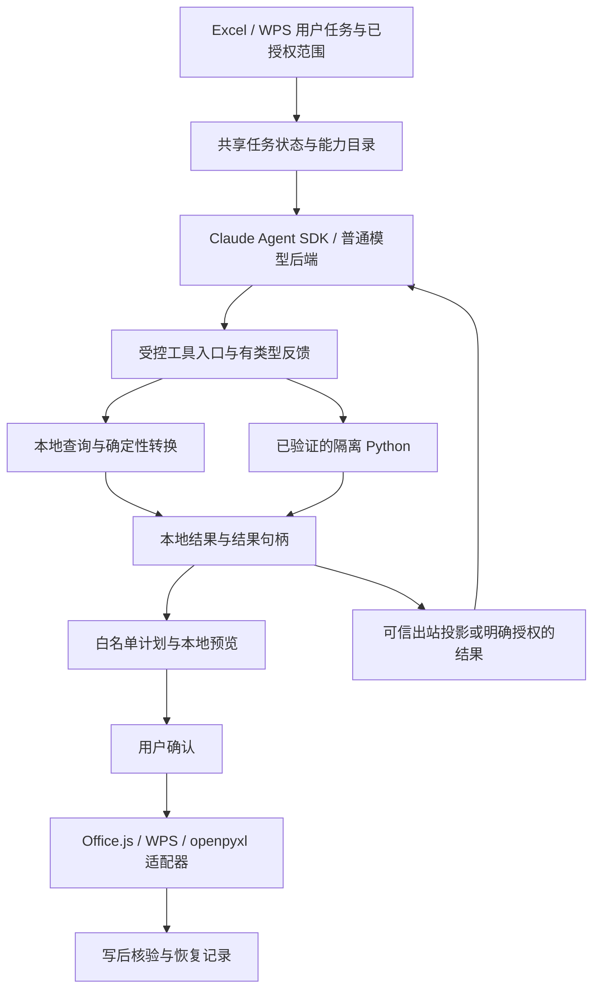

# Claude Agent SDK 接入诊断与表格能力扩展建议

日期：2026-10-09。目标：尽可能全面地完成用户的表格任务，覆盖 Excel、WPS 和文件夹模式。

本文是当前工作区的代码诊断与实施建议，未启用新能力，未修改运行时、协议或配置。工作区已有大量未提交改动，诊断以这些现有文件为准。本文不把配置声明、自动化测试和真实宿主验收混为一谈。

## 1. 判断

Claude Agent SDK 已经接入项目，但当前适配只发挥了结构规划、规则生成和终局提交能力。要增强产品，需要同时贯通三个层面：

1. SDK 可以连续调用项目的受控工具，观察允许的反馈并修正方案。
2. 本地工具可以完成通用数据处理与隔离 Python 分析，并把结果交给用户审阅。
3. Excel/WPS 的宿主适配器可以执行、验证和恢复相应表格操作。

SDK 不自带 Excel/WPS 操作实现。调整模型、超时或权限配置，不能补上缺失的执行分支。项目已经有共享协议、确定性工具、授权守卫、白名单执行器与隔离运行器，可以在这些基础上接通能力，无须整体推倒重写。

## 2. 已核实的断点

| 断点 | 当前代码证据 | 对用户任务的影响 |
|---|---|---|
| SDK 缺少可工作的分析工具循环 | `server/app/claude_sdk_agent.py:run_sdk_plan` 注册 `AGENT_TOOLS_WITH_DATA`；该集合在 `excel_agent.py` 中实际只有 `submit_plan`、`map_column_values`、`submit_clarification`、`submit_answer` 四个终局工具 | 可以提交方案，但缺少查询、计算、查看反馈、继续调整的完整链路 |
| 已算好的查询结果不能进入 SDK 规划 | `run_sdk_plan` 在 `planningReadPolicy != none` 或 `dataResults` 非空时直接拒绝；WPS `runWpsTurn` 的 `tool_request` 分支会本地查询后携带 `dataResults` 进入规划 | 一些普通查询可能完成了本地计算，却在生成回答阶段被 SDK 入口挡住；这是可达的代码路径，本轮未作真实模型复现 |
| Python 开关后面仍有未实现的产品路径 | `pythonExecution.enabled=false`；即使开关打开且运行器就绪，`python_analysis.execute_python_analysis` 仍返回 `REASON_PRODUCT_NOT_READY` | 改成 true 也不会得到可用的 Python 分析产品 |
| Python 基础设施与用户流程断开 | 已有 `run_registered_result_internal`、易失数据/结果登记、`pythonResult.ts`、两端 `*PythonData.ts` / `*PythonResult.ts`；内部函数注明无模型/HTTP 执行路由 | 现有模块可复用，但还缺可信任务绑定、工具执行接线、用户结果入口、原生审阅与确认写回 |
| 缺少 SDK 任务连续性 | `_result` 每次独立 `sdk.query`，仅提取 `ResultMessage.result`；没有使用 SDK session ID / resume；设置 `no-session-persistence` | `taskContext` 已保留原需求和用户确认，但不包含完整执行状态、中间结果或精确恢复现场 |
| SDK 未共享动作 schema 的按需加载 | 普通后端调用 `_planning_tools` / `select_plan_actions`；SDK 直接注册完整终局定义 | SDK 模型仍可看到不适合当前宿主的动作参数，提交时才校验拒绝；增加无效尝试的可能。本轮未测量其真实延迟影响 |
| SDK 工具过程不可充分观察 | `_result` 跳过中间消息；SDK 自定义事件主要为规划开始与终局完成 | 用户难以区分正在调用哪个工具、哪步失败、是否仍有进展 |
| WPS 执行动作不足 | `wpsPlanExecutor.ts` 仅接受写值、写公式、清空内容；`wpsWrite.allowedActions` 同样只有三类 | SDK 再强也不能在 WPS 直接完成图表、排序、格式、透视表等尚未接入的动作 |
| 预览能力窄于执行清单 | Excel 原生副本审阅有限定的单表/动作范围；两端 Python 准备器只准备、不创建副本或写回 | 新增动作还必须补齐可审阅、写后验证与恢复，不能只实现 setter |

数量口径：Excel 配置在 `16.0` 下标记 40 个动作/变体为 supported，对应计划表中 37 类动作；WPS 为 3 个 supported、37 个 unverified 变体。现有计划表明确列出 WPS 其余 34 类动作尚未接入执行链。因此这里的 unverified 不能解释成“都实现好了，只差实机验收”。数量不表示任务完成率。

本机已安装 `claude-agent-sdk==0.2.159`、`mcp==1.23.0`。并非单纯缺少 Python SDK 包。Windows 子进程启动约束已有检测和 `scripts/start_claude_sdk_server.ps1` 启动脚本；本轮未重启现有服务，也未核实运行中服务采用了哪种启动方式。

## 3. SDK 应承担的职责

建议把 SDK 作为一种 Agent 调度后端；普通模型后端继续共用相同的工具语义、授权和结果协议。业务能力由项目的共享工具和宿主适配提供。



推荐逐步提供以下工具能力；名称除已有工具外仅为建议，不代表当前 API：

- 查询本任务可用的表、字段、范围和宿主能力，只返回已授权结构。
- 发起本地确定性查询、筛选、分组、关联与清洗，结果在本地登记。
- `run_python_analysis` 接收本任务已登记的数据句柄和代码，经可信协调器执行。
- 查看允许的结果状态、结构和验证反馈；值矩阵默认只给本地用户界面。
- 生成已有 `AnalysisPlan`、验证方案并修正参数，最终通过 `submit_plan` 进入预览。
- 只有缺少业务决定时使用 `submit_clarification`，已有确认从共享任务状态读取。

现有宿主 API 差异应留在适配层。Excel/WPS 共用 TypeScript 确定性逻辑；文件夹 Python 实现以同一协议和任务样例验证语义。避免在 SDK 适配器再复制一套业务规则。

必须区分“本地计算能访问授权数据”和“远端模型可以收到这些数据”。要让模型解释数值、判断异常原因，可以设计双端一致的结果出站选择，让用户明确选择接收模型、结果字段和范围。未作此授权时仍能本地计算并展示结果，但不能声称模型已经读过结果作出解释。意图阶段继续只使用允许的结构信息。

## 4. 全面表格功能的能力账

每项都应分别记录 Excel、WPS、文件夹的实现、限制、预览、写入、回读、恢复和实机证据。以下是排期范围，不是本轮新增能力。

| 能力组 | 需要覆盖的任务 | 当前优先补齐内容 |
|---|---|---|
| 读取和理解 | 表头定位、数据类型、公式与显示值、隐藏/合并结构、已授权多表 | 统一结构目录与数据来源；分开宿主读取和模型出站 |
| 基础编辑与公式 | 批量填值、公式矩阵、引用变化、填充、复制、查找替换、错误检查 | 验证不同宿主公式语义和重算结果；SDK `/function` 等子入口另行接入 |
| 清洗和转换 | 去重、空值处理、文本/日期/数值规范化、拆分合并、条件映射、转置 | 共享确定性转换与输入/输出句柄，避免每种需求新写一套提示词 |
| 跨表分析 | 关联、追加合并、分组汇总、对账、差异、窗口统计、复杂计算 | 贯通本地查询与隔离 Python；保留明确关联键与计算口径 |
| 格式和规则 | 字体、颜色、数值格式、边框、尺寸、冻结、条件格式、验证规则 | WPS 适配实现与属性快照/回读；不能只增加白名单 |
| 结构操作 | 新建表、插删行列、合并区域、表对象、名称、排序与筛选 | 引用变化、影响范围和恢复策略；扩展多表审阅 |
| 图表和透视 | 创建、更新数据源、布局与样式、汇总口径、刷新 | 分别验证原生对象及对象恢复；汇总矩阵不能冒充原生透视表 |
| 文档对象和输出 | 批注、备注、图片、形状、打印设置、导出 | 逐项宿主能力探测；当前动作清单存在名称不等于完整对象生命周期 |
| 多文件处理 | 选中文件/表的批量清洗、汇总、跨文件关联与输出 | Excel 有文件夹通道；WPS 文件夹入口仍未实现；openpyxl 与宿主计算语义单列 |
| 连续工作 | 澄清、结果追问、修改方案、取消、断线核对、可复用任务 | 共用任务状态和结果引用；SDK 会话恢复、执行恢复分别处理 |

“全面”应以这些任务的可靠完成为目标。宏/VBA、宿主任意命令仍不在现有项目授权内；宿主无法提供的能力应记为具体限制。

## 5. 建议实施顺序

### 第一批：贯通一个有实际价值的完整任务

验收任务：选中两张表 → 指定关联键 → 清洗并关联 → 分组汇总 → 在本地查看结果 → 选择已授权目标区域 → 审阅 → 确认写入 → 回读验证。

Excel 与 WPS 使用同一套合成数据和业务规则。第一批可在已有三类写入动作范围内返回结果矩阵；明确标注其不包含原生透视表或图表，不以矩阵结果宣称高级对象已完成。这个案例能同时暴露工具、数据、SDK 调度、预览和写入的断点。

具体工作：

1. 抽取共用的工具注册、宿主能力裁剪和结果投影。SDK 先按当前宿主裁剪 `submit_plan` schema，再验证固定 SDK 版本支持的按需工具机制；不照搬普通后端的动态 schema 轮换。
2. 接通非终局本地查询工具的任务请求/回执。复用现有读取与计算模块；客户端负责真实宿主读取，服务端任务协调器把请求绑定到本次授权。
3. 解决查询结果在 SDK 入口被拒绝的产品断点：已知查询可由本地类型化展示器直接输出；需要模型解读时走明确的出站契约。不能直接放开任意 `dataResults` 或任意 dict。
4. 在既有任务身份上登记操作 ID、数据/结果引用、来源版本、执行状态与错误类别，防止超时后重复计算或把旧结果接到新授权。
5. 双端接入结果卡、目标选择、预览及确认写回。涉及 Python 结果的值矩阵不能进入旧远端校验或持久账本；先完成相应非持久执行/会话内恢复路径。
6. 增加真实工具开始、完成、拒绝、取消事件。预算与轮次耗尽返回可识别原因，避免所有停止均显示为“未能完成本轮请求”。

主要落点：`server/app/claude_sdk_agent.py`、`excel_agent.py`、`planner.py`、现有任务服务、`packages/core/src` 以及两端面板和宿主适配器。新增协议同步 TS/Python，限额仍放 `config/capabilities.json`。

### 第二批：接通隔离 Python 产品流程

复用现有数据登记、运行器和结果登记；重点补齐 `execute_python_analysis` 到可信任务协调器的调用。不能让模型自报 task/scope/handle 就获得权限，也不能把内部测试入口直接暴露为公共执行接口。

需要同时解决：工具调用与可信授权绑定、任务累计配额、取消/迟到结果、模型可见回执、双端结果界面、原生预览、写回与恢复。先证明整条流程，再决定启用开关。

SDK 内部转录仍是独立待解决项：当前工具输出投影不证明模型生成代码等内部历史也被投影。应针对固定 SDK/CLI 版本验证数据流与留存行为。若当前接口不能满足已批准的隐私约定，应给出具体缺项及替代设计，不能通过删除守卫把它宣称为已完成。隔离 Python 运行与 SDK 会话持久化分别验收。

### 第三批：扩展宿主动作、预览和恢复

推荐按用户频率推进：格式/尺寸/冻结 → 复制/排序/筛选/去重 → 工作表与行列结构 → 图表/透视表/对象。

每一组同步补齐 Excel/WPS 的任务语义、预览、执行、回读、撤销/恢复；文件夹行为单列。已经存在的 Excel 实现可复用协议和算法，但不能复制配置标记代替 WPS API 实现。

WPS 当前写入限额为 1,000 格，正式验证版本名单为空；复杂分析结果规模与发布覆盖需要独立测试后调整。Python 默认结果上限为 500 行、50 列、20,000 格，数据集上限为 20,000 格，也会影响“大数据任务”，不能把读表的一百万格上限当作所有链路容量。

### 第四批：连续任务、能力封装与发布

先让共享任务状态保存已确认业务规则、可用结果引用与真实进度；结果过期时明确重新读取计算。后续再设计 SDK 原生 resume 与会话生命周期，绑定任务、连接、宿主和授权版本，禁止使用全局“最近一次会话”串接不同工作簿。

SDK 会话恢复不等于恢复本地数据、沙箱或工作簿写入。恢复仍需独立检查授权、来源和执行状态。`taskContext` 目前最多 8 项确认，应在确认真实复杂任务需求后设计容量与压缩方式，不依赖无限历史。

最后接入可复用业务流程、SDK 与隔离环境的安装诊断、打包和目标机器验收。完整 SDK 子功能、图片、公式短链、文件夹、普通后端与 SDK 后端分别列验收项。

## 6. SDK 官方能力与本项目约束

- 官方支持进程内 MCP 自定义工具，可将项目函数暴露给 Agent；因此保留内置宿主工具禁用，并不阻碍表格能力扩展。[自定义工具](https://code.claude.com/docs/en/agent-sdk/custom-tools)
- 官方有 `ClaudeSDKClient` 与按 session ID 恢复的机制。本项目尚未接入；SDK 会话保存的是对话，不自动恢复工作簿或隔离计算状态。[会话机制](https://code.claude.com/docs/en/agent-sdk/sessions)
- 官方 hooks 可拦截工具并调整输出，但不能仅凭这一点推断内部全部转录都能被清除或替换。[Hooks](https://code.claude.com/docs/en/agent-sdk/hooks)

官方在线文档会更新；以上仅确认能力方向。实现必须对照已安装的 `0.2.159` 及其实际 CLI 验证。本地源码目录与安装包版本不同，不能把源码样例视为安装包已经支持的行为。

SDK 与模型也应分开测试。项目允许已保存的 DeepSeek 官方连接派生 SDK 连接；这不代表底层模型变成 Claude。不同供应商的工具调用、结构化输出、错误恢复和预算行为需要独立端到端样例。

## 7. 本次验证与后续验收

本次执行：

```powershell
.\.venv\Scripts\python.exe -m pytest server/tests/test_claude_sdk_agent.py server/tests/test_agent_task_context.py server/tests/test_python_analysis.py server/tests/test_python_datasets.py server/tests/test_python_results.py -q --basetemp=.tmp-sdk-assessment-20261009-a -p no:cacheprovider
```

结果：185 passed。SDK 测试使用替身，证明分发、现有拒绝行为与结果约束；不证明真实模型、真实宿主或当前 Docker 引擎端到端可用。本轮没有发起模型付费请求、修改真实工作簿、安装依赖、开启 Python 或进行提交。

后续每批都应验证：真实多轮工具调用、字段歧义只问缺项、修改已答口径、跨表关联、源值变化使旧预览失效、取消后无迟到写入、断线后先核对、写入中断恢复和结果隐私。Excel/WPS 使用同一任务集；宿主版本、实际回读、恢复结果分别留证。

实施代码变更后按 AGENTS.md 完成两端测试/构建、服务端全量测试和 compileall；运行时、协议、架构或启动配置发生变化时同步 README 与架构/开发文档。旧 `SDK_TRANSFORMATION_*` 索引已经标记停用，不能照其历史“直接复制”“几天完成”内容实施。
