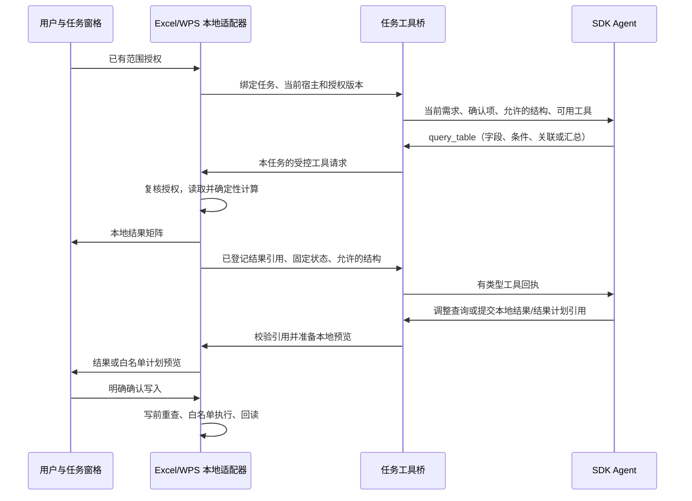

# SDK 实际工作流程：实施指导

日期：2026-10-09。本文是待实施方案，不代表已接线能力。配套执行提示词见 [SDK_WORKFLOW_IMPLEMENTATION_PROMPT_2026-10-09.md](./SDK_WORKFLOW_IMPLEMENTATION_PROMPT_2026-10-09.md)。

## 1. 本轮目标和完成定义

让用户在 Excel/WPS 选定范围后，SDK 能在一次任务内主动调用本地表格工具，接收允许的反馈，必要时调整参数、继续查询，最终展示真实本地结果，或提出可审阅的白名单写入方案。

必须出现真实的“模型调用工具 → 本地执行 → 有类型回执 → 模型继续”路径。仅新增 MCP 名称、返回假数据、让模型描述操作步骤、或让前端在模型调用前一次算完，都不能代替这项验收。

本轮使用现有确定性 `query_table` 能力。隔离 Python 产品入口、SDK 转录持久化、34 类 WPS 新动作另行实施；这些能力不应成为接通本轮工具链的前置条件。保留原消息理解与意图阶段的无原始行边界。

此前诊断中的“两表关联、汇总、审阅写入”是整条链的最终验收案例。这里拆成 A—D 四个可分别验证的里程碑，全部完成后才标记本轮闭环完成。

## 2. 三条数据流



分别处理：

- **模型通道**：只接收已允许的结构、工具定义、固定状态和本任务已登记的公开结果引用。
- **本地结果通道**：保存/显示值矩阵与来源绑定，不把它们放进模型工具回执。
- **写入通道**：根据合法结果在本地构造 `AnalysisPlan`，经过预览、确认和宿主执行器。

本轮默认不新增结果值出站授权。模型可以根据字段、用户规则和状态选择查询方法，但不能根据它未见过的数值作分析结论。结果卡由可信本地渲染器展示真实值。未来需要模型解释数值时，再单独实现明确的出站选择及契约。

## 3. A：共用工具契约与宿主能力裁剪

复用现有工具 schema、计划校验和能力交集。把 SDK 与普通后端共用的工具定义、分发和回执投影收敛到同一来源，避免在适配器另写业务规则。

建议工具集合（新增名称仅为设计建议）：

| 工具 | 类型 | 实际作用与回执 |
|---|---|---|
| `describe_authorized_tables` | 非终局 | 返回允许的已授权表结构；从白名单字段重建，不能直接返回 workbook/snapshot 对象 |
| `query_table` | 非终局 | 调用现有确定性查询；返回本任务结果引用、固定状态和允许的结构 |
| `submit_local_result` | 终局 | 选择已登记结果在本地显示；不让模型重新生成结果矩阵 |
| `submit_result_plan` | 终局 | 提出结果引用及明确目标，可信本地层编译并验证计划；只进入预览 |
| `submit_plan` | 终局 | 保留现有直接计划路径及全部宿主能力校验 |
| `submit_clarification` | 终局 | 只请求尚未确认的业务决定；沿用原需求及明确确认 |
| `submit_answer` / `map_column_values` | 终局 | 保留已有回答和本地映射行为 |

`query_table` 已有字段选择、筛选、分组、指标、排序、limit 和 combine 的 union/deduplicate/join 协议。应先核实不同执行端的实际支持，再复用，不用工具名字推断全部实现完成。

按宿主、版本、真实能力交集裁剪 schema，包括 `clearRange.applyTo` 等动作变体。SDK 初期可静态注册本任务需要的受控工具；不能假定普通后端 `_planning_tools` 每轮更换 schema 的方式可直接搬到 SDK。

保持内置宿主工具禁用，精确列出允许的 MCP 全名。阶段 A 验收重点是工具协议真实一致、不可用动作不出现在候选中、非法终局仍被拒绝。

## 4. B：接通 SDK 与真实宿主之间的异步工具桥

这是本轮最关键的新实现。SDK 运行在 Python 后端，Office.js/WPS API 在任务窗格，单纯注册 Python MCP handler 不能直接读取当前未保存的工作簿。

推荐采用“SDK handler 等待结果 + 易失工具请求投递 + 客户端回执”的方式：

1. SDK handler 经统一异步 dispatcher 提交查询，任务协调器生成 operation ID 并绑定当前调用上下文。
2. 工具桥将请求交给拥有本任务的宿主适配器。宿主复核授权与身份后执行现有读取/查询模块。
3. 结果矩阵留在本地易失结果登记器；来源、授权版本和源指纹与结果绑定。向桥提交经过白名单重建的回执。
4. handler 等待匹配回执，投影后交给 SDK；同一次 `query()` 继续工作。同步耗时操作不得阻塞负责回执的事件循环。

必须明确解决以下实现细节：

- 所有权绑定覆盖 task/turn、宿主实例、工作簿身份、授权版本、操作 ID、有效期和取消代次。复用已有身份机制；不能只比较模型或客户端自报的 taskId。
- 公共 resultRef 是任务内引用，私有回执凭据不能传给模型或记入 URL/历史。任何引用都要在可信登记器查归属；知道字符串不等于获得读取权限。
- 工具请求通道与持久进度日志分开。可以复用传输设施，但不能把工具凭据、完整请求、值矩阵直接塞进现有会落盘的 SSE 事件/账本。
- 新增本机桥沿用回环、Origin/hostId 与会话校验；不能依靠 CORS 或可猜 taskId 单独授权。旧前后端通过能力/协议版本协商拒绝不支持的桥，不降级上传数据。
- 同一 operation 的重送不能重复运行；相同 ID 不同参数应拒绝。取消、撤销、换簿后拒绝迟到回执；断线先查真实状态。页面重载导致易失结果丢失时明确重新读取计算。
- 第一版同任务数据工具可串行执行，避免源版本和终局竞争；终局只接纳一次，终局后不再调度查询。
- 在 capabilities 中设置工具次数、任务累计读取量、等待时间和结果容量。SDK max_turns 与工具次数分别约束，预算耗尽返回明确原因。

复用 `taskContext` 传递用户语义确认；另建有明确类型的内部运行状态。不要往当前只允许“原需求+确认”的 taskContext 偷塞授权、矩阵或原始转录。

模型可见回执建议只包含固定状态、已验证结果引用、允许的字段结构、固定错误码及必要的完整/截断状态。不能自动上传 `DataToolResult.rows/title/calculation/warnings/scannedRows`；其中数值、自由文本或错误文本可能来自原数据。受数据影响的结构也需明确列入投影规则，不能因字段名叫 headers 就自动放行。

若需要对上一结果再查询，必须显式建模结果输入和来源链；不能把 resultRef 填进 sheetId 伪装成工作表。本轮至少实现一次真实查询及一次由反馈触发的继续/参数修正，结果集级联作为明确能力验收。

### 已有 dataResults 路径的处理

当前两端已有“意图给出 tool_request → 本地查询 → 携带 dataResults 规划”的路径。SDK 新流程需让该分支将结果留在本地并登记安全引用，或把同一查询交给工具桥完成。不得重复执行，也不得先把 rows 放进 HTTP 请求、再指望 SDK 提示词投影弥补出站。

服务端原有数据行拒绝守卫继续有效；新能力通过新契约进入。旧客户端若直接提交含值 dataResults，仍返回清楚的升级/能力提示，不静默改供应商。

## 5. C：结果展示与白名单计划预览

只读任务以本地结果卡结束；需要写入时走结果引用到本地计划的受控编译。

- 目标表和范围必须来自明确用户需求或可信目标选择流程，限于当前已授权范围；缺失时结构化询问。
- 本地编译器验证矩阵类型、尺寸、公式文本、目标范围、重叠、宿主限额和来源版本。只生成已有可执行的 AnalysisPlan 动作。
- 模型提交的结果引用、目标和规格只是提案，不能直接触发宿主 setter。
- 不能直接把现有 Python 结果准备器当通用入口：它受 Python 总开关和专用登记语义约束。可抽取共用的纯编译/校验部分，但不得为复用而打开 Python 或绕开登记。
- 当前原生预览有单表限制。跨表来源、一张目标表的结果写入，要明确区分“全部来源授权”与“本次副本目标”；不能偷偷把授权列表改成一张来绕过现有检查。预览和写前仍核对全部来源依赖。
- 本地查询结果矩阵采用明确的保留策略：本轮新增句柄流程默认不把矩阵发往远端校验、模型、聊天历史或持久账本；必须验证原执行/撤销路径是否会落盘。需要时实现会话内执行与恢复，不能直接调用旧路径后声称隐私成立。
- 恢复材料缺失时明确状态，不能用重新规划覆盖写入未知。既有任务暂停/查询/恢复行为不能退化。

## 6. D：双端验收、文件夹兼容与诊断

所有自动化样例使用合成数据。至少覆盖：

1. 两端 SDK handler → 工具桥 → 真实确定性查询 → 类型化回执 → SDK 下一步 → 结果卡；测试不得 mock 掉整条桥。
2. 同一任务至少两次非终局调用，含一次可修复字段/参数错误；真正缺少关联键时通过澄清卡保留答案继续。
3. 两表关联并汇总，值矩阵正确；需要写入时生成预览，确认前零写入，确认后回读匹配。
4. 数值、伪装在 warnings/异常中的哨兵、路径等不进入实际模型请求、实际回执 HTTP、持久事件与存储。
5. 越权表、跨任务引用、重授权、换簿、源数据变化、重复/冲突回执、取消及迟到事件被正确处理。
6. 断线与重载分别验证；SDK 进程丢失不冒充精确检查点恢复，未知运行不自动重新发起。
7. 普通后端、已有 SDK 图片输入、映射、澄清、直接计划和窗口预览保持回归通过。

文件夹模式复用已登记的文件/工作表 ID 和 `query_folder_data`，不向模型开放路径。应核实 `/api/folders/query` 现有返回包含完整 DataToolResult，新增桥必须在本机消费并投影。WPS 文件夹 UI 未实现，单独记账，不能把共享后端通过称为双端入口已完成。

自动化、真实 SDK/供应商、真实 Excel、真实 WPS 分四列记录。真实模型使用明确的测试连接与合成结构，并满足既有调用授权；没有相应环境时继续完成可做的代码/测试，列出具体缺口，不能把替身测试当真实验收。

## 7. 代码落点与交付物

| 区域 | 主要已有入口 | 需要交付 |
|---|---|---|
| SDK | `server/app/claude_sdk_agent.py` | 异步工具处理、真实进度、清楚停止原因、单次 query 内多轮 |
| 共用规划 | `server/app/excel_agent.py`、`planner.py` | 工具目录/裁剪/校验/投影共享，兼容原后端 |
| 协议与任务 | `server/app/models.py`、`main.py`、已有任务服务 | 版本化桥协议、易失操作登记、归属校验、取消与幂等 |
| 共享前端 | `packages/core/src`、`apps/excel-addin/src/contracts.ts` | 桥客户端、结果引用、共享状态机和本地编译 |
| Excel | `App.tsx`、`dataTools.ts`、现有 Office 读取/预览/执行器 | 工具请求实际接收与宿主读取、结果卡、预览写回 |
| WPS | `WpsAgentPanel.tsx`、`wpsReadonlyAgent.ts`、WPS 读取/预览/执行器 | 相同任务语义与边界，复用共享计算 |
| 文件夹 | `server/app/folder_data.py`、现有查询入口 | 已登记 ID 下的等价查询和本机结果投影 |

每个里程碑更新计划表中的 Excel/WPS/文件夹状态与证据。架构、协议、启动或配置有变动时同步 README、ARCHITECTURE、DEVELOPMENT。完整检查包括 test:core、test:addin、build:addin、test:wps、build:wps、服务端全量 pytest、compileall。

## 8. SDK 运行时提示词草案

下面模板只在相应工具已经实现并注册后使用。花括号变量必须由可信代码注入，工具名从当前实际注册表生成。

```text
你是 Excel Bro 表格助手。你的目标是在用户当前授权的数据范围内完成表格任务。

当前宿主能力：{validated_host_capabilities}
已授权的结构信息：{authorized_structure}
原需求与用户明确确认：{validated_task_context}
本轮实际可用工具：{registered_tool_descriptions}

需要数据计算时调用本地工具，不根据表头猜测计算结果。工具回执中没有数据值，
就不能声称你看过数值、比较过大小或识别出了异常。真实结果由本地结果卡展示。

可在同一任务内多次调用工具。先利用已知结构和用户规则确定参数；可修复的
参数错误根据固定错误码修正。缺少业务决定时提交结构化澄清，只问真正缺项。
用户修改同一问题的答案时使用最新确认。

只使用本任务可信登记的结果引用。过期、来源改变、授权改变或取消后，
按工具状态结束或请求重新读取，不能编造引用、绕过范围或宣称已经恢复。

只读任务提交本地结果引用或有依据的回答。写入任务提出已有白名单计划，
或提交结果引用及已明确的目标交由本地编译、预览。提交不等于执行；
用户确认和真实宿主回读之前，不说“已写入”“已修改完成”。

在可用工具和预算内推进。连续不可恢复错误、工具不可用或预算耗尽时，
说明真实状态和下一步需要的条件，不重复调用同一失败操作。
```

官方依据：[自定义工具](https://code.claude.com/docs/en/agent-sdk/custom-tools)、[会话](https://code.claude.com/docs/en/agent-sdk/sessions)。一次 query 内已有 Agent 工具循环；跨请求会话是另一项能力。具体接口以项目锁定的 SDK/CLI 实测为准。
